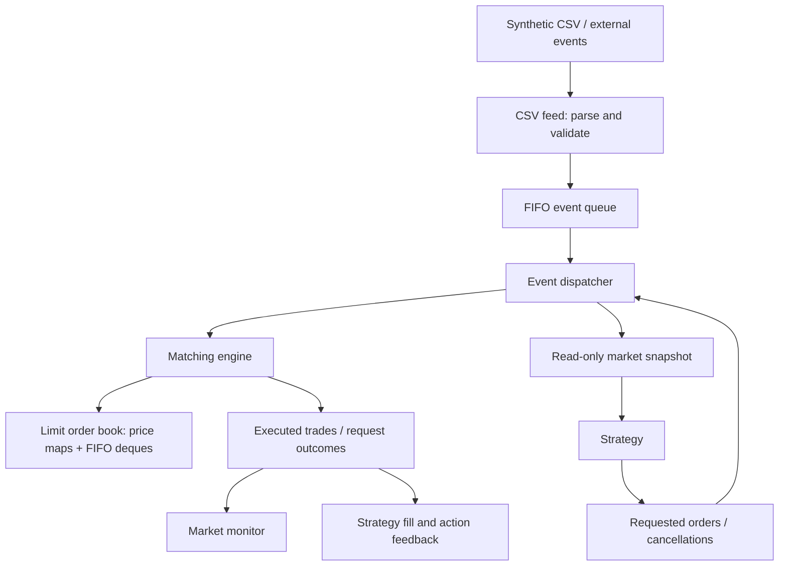

# C++ Trading Simulator

**A deterministic exchange simulator with a limit order book, matching engine, event replay, and a strategy interface.**

I’m building this project to understand how trading infrastructure works from the
inside: how orders gain priority, how executions change the book, and how a
strategy can interact with an exchange without bypassing its rules.

The long-term goal is a system for testing trading strategies with market-data
replay, positions and P&L, explicit execution assumptions, and measured performance.
Today, it is a working single-threaded exchange simulation with synthetic CSV
replay and an example strategy. Historical backtesting and performance
benchmarking are still ahead.

- **Stack:** C++17 · STL · CMake · CTest · Git/GitHub
- **Current milestone:** Phases 1–6 implemented at a functional level
- **Verification:** Eight passing CTest entries: six test executables and two CLI replay checks

## See it run

Requirements: CMake 3.20+ and a C++17 compiler. Developed and tested on macOS
with AppleClang; CMake also includes warning options for GCC, Clang, and MSVC.

```bash
cmake -S . -B build
cmake --build build
ctest --test-dir build --output-on-failure

# Replay exchange arrivals
./build/trading-simulator data/example_events.csv

# Replay with a strategy: threshold price, quantity, order ID
./build/trading-simulator data/example_events.csv --buy-below 10100 10 100
```

An excerpt from the strategy replay:

```text
Event 1 ID 1: 0 trades, remaining=100, resting=1
Event 2 ID 100 [strategy]: 1 trades, remaining=0, resting=0
  TRADE maker=1 taker=100 price=10100 quantity=10
```

The strategy observes a resting ask, requests a buy, and receives an execution
at the resting price. Prices are integer ticks: with a one-cent tick, 10100
represents $101.00.

## What works today

| Component | Current behavior |
| --- | --- |
| Order model | Limit/market orders, optional price, original/remaining quantity, input validation |
| Limit order book | Sorted bid/ask levels, FIFO within a price, best-price queries, cancellation |
| Matching engine | Price-time priority, maker-price execution, partial fills, multi-level sweeps |
| Event pipeline | New-order/cancel events, input-order dispatch, execution monitoring |
| CSV feed | Strict parsing with line-numbered errors before replay begins |
| Strategy interface | Read-only snapshots, requested actions, own-order cancellation, execution feedback |
| Example strategy | One limit-buy attempt when the best ask reaches a configured threshold |

Unfilled limit quantities rest in the book. Market remainders are cancelled.
Fully filled orders and empty price levels are removed. IDs must be unique
among resting orders and can be reused after removal.

## Architecture

The matching engine owns the book. The dispatcher coordinates external events,
strategy requests, and trade notifications. Strategies receive market values,
rather than mutable exchange objects.



After each external event, fills are reported and the strategy receives a fresh
snapshot. Its requested actions run in returned order before the next external
event. Those actions do not recursively trigger more market-update callbacks.
This policy is synchronous and currently assumes zero simulated strategy latency.

The production code builds into a reusable `trading_core` static library. The
CLI and test executables both link the same implementation.

## Decisions and tradeoffs

### Ordered trees for prices; FIFO queues for orders

The book uses `std::map<Price, PriceLevel>` for asks and a descending comparator
for bids. Each `PriceLevel` is a `std::deque<Order>`.

A heap would expose the best price efficiently, but finding arbitrary price
levels and supporting cancellation would require additional machinery. Ordered
maps provide sorted traversal and logarithmic price-level lookup. Deques let new
orders join the back while execution consumes the front.

Best bid/ask are derived from the first map entry, avoiding separate cached prices
that could become stale after cancellation or execution. The supplied timestamps
do not reorder equal-price orders.

### Input order represents exchange arrival

A client can create an order earlier but reach the exchange later because of
network delay. Sorting by that client timestamp could incorrectly change priority.

The dispatcher therefore treats input order as the authoritative exchange arrival
sequence. It assigns increasing sequence numbers across runs; timestamps remain
metadata, including when they decrease or tie. A future historical-data adapter
will need to preserve the source exchange's ordering semantics.

### Strategies request actions through a read-only boundary

`MarketView` is a value snapshot with best bid, best ask, sequence, and timestamp.
It contains no engine or book reference. Strategies implement `on_market_update`
and return requests; the dispatcher submits them through normal engine validation.

This separates trading decisions from execution rules and lets strategies be
tested independently. The dispatcher tracks strategy-owned resting IDs, restricts
strategy cancellation to those IDs, and routes maker/taker fills back through
`on_fill`. Rejections and cancellation outcomes arrive through `on_action_result`.

The barrier is an API boundary inside one process, so it requires neither network
messaging nor another thread. Only one optional strategy is supported today.

### Integer ticks and explicit absence

Prices use signed integer ticks, avoiding floating-point rounding during price
comparisons. `std::optional<Price>` expresses the absence of a market-order limit
without inventing a sentinel such as zero.

Order construction rejects zero IDs, zero quantities, and invalid price/type
combinations. Filling an order checks quantity before mutation. Original quantity
remains unchanged while remaining quantity decreases.

### Correctness before optimization

The engine stages each submission on a book copy and commits it after successful
processing. This protects the original book if matching or remainder insertion
throws, but costs O(N) copying per submission.

Duplicate detection and cancellation also scan resting orders in O(N). These are
known tradeoffs, not performance achievements. An order-ID hash index and an
alternative commit mechanism are candidates for later measurement and redesign.

The system remains single-threaded so arrival order and state transitions are
easy to reason about before introducing concurrency.

## Engineering challenges addressed

**Keeping FIFO correct during cancellation.** Removing one order must preserve
the relative order of its neighbours. Removing the final order at a price must
also remove that tree node so best-price queries cannot point at an empty queue.
Tests cover front, middle, and back cancellation on both sides.

**Conserving quantities across partial fills.** One incoming order may consume
several makers and price levels. The engine executes the smaller remaining
quantity, removes only fully filled makers, and either rests or cancels the
incoming remainder according to its order type.

**Rejecting duplicates before execution.** Checking an ID only when inserting a
remainder is too late: a duplicate could already have traded. The engine checks
resting IDs before matching begins.

**Separating trade activity from strategy ownership.** Observing every trade
does not mean every trade belongs to the strategy. Ownership tracking distinguishes
its maker and taker fills and clears ownership after removal, preventing a reused
ID from inheriting stale attribution.

**Making tests exercise the actual build.** Early build issues included missing
source files in the library and a stale test executable that was no longer a CMake
target. Explicit source lists, linked test targets, and CTest registration ensure
the current implementation is built and exercised.

## Concepts applied

| Area | Concepts used |
| --- | --- |
| C++ modelling | Classes, private state, constructors, initializer lists, const methods, namespaces, fixed-width aliases |
| Type design | `enum class`, `std::optional`, `std::variant`, value snapshots |
| Ownership and interfaces | `std::unique_ptr`, virtual interfaces/destructors, move semantics, RAII |
| Data structures | Ordered maps, FIFO deques, vectors, ownership hash set, iterators |
| Software design | Encapsulation, separation of concerns, event dispatch, explicit invariants, deterministic replay |
| Reliability | Exceptions, validation before mutation, staged engine updates, regression tests |
| Build tooling | CMake targets, static libraries, include propagation, compilation vs linking, CTest |

## Verification

```bash
ctest --test-dir build --output-on-failure
```

- Order tests cover construction, getters, invalid inputs, and fill quantities.
- Book tests cover price ordering, FIFO preservation, duplicates, and cancellation.
- Matching tests cover both sides, maker prices, multi-level execution, limit
  boundaries, and market/limit remainders.
- Event tests cover arrival order, timestamp ties, rejection handling, cancellation
  timing, and CSV parsing.
- Strategy tests cover snapshots, action ordering, ownership restrictions,
  feedback, fill attribution, and the threshold example.
- Startup and CLI checks exercise the executable entry points.

Eight CTest entries represent multiple checks inside six test programs plus two
CLI smoke tests; they are not a claim of eight individual unit assertions.
No throughput, latency, or coverage metrics have been measured yet.

## Replay format

```csv
event,id,side,type,price,quantity,timestamp
NEW,1,SELL,LIMIT,10100,100,30
NEW,2,SELL,LIMIT,10100,50,10
NEW,3,BUY,LIMIT,10100,120,20
CANCEL,2,,,,,40
NEW,4,BUY,MARKET,,10,50
```

Columns and the header are exact. Tokens are uppercase; quoting and surrounding
whitespace are unsupported. Blank lines and CRLF are accepted. IDs and quantities
must be positive, and timestamps must be nonnegative integers. Market prices
are blank. Cancellation leaves side, type, price, and quantity blank.

Parsing completes before execution. Malformed rows abort with a line-numbered
error. Engine rejections become result records and replay continues; unknown
cancellation IDs return not-found. A completed replay exits with status 0 even
if individual requests were rejected; input/file errors exit with status 1.

The example strategy makes one attempt, even if rejected. Its configured ID
shares the exchange namespace and should not collide with a resting feed order.

## Repository layout

```text
include/trading/   Public domain types and component interfaces
src/              Core implementations and CLI entry point
tests/            Automated checks linked against trading_core
data/             Synthetic replay fixture
benchmarks/       Reserved for future benchmark work
CMakeLists.txt    Library, application, and test targets
```

## Next milestones and vision

- [x] Project/build setup, order model, and automated tests
- [x] Passive price-time-priority book and matching engine
- [x] Synthetic event replay and read-only strategy interface
- [ ] Positions, cash, realized/unrealized P&L, and accounting tests
- [ ] Historical-data adapters with documented fill and queue assumptions
- [ ] Broader strategies, fees, and simulated execution latency
- [ ] Throughput/latency benchmarks and profiling
- [ ] Measured data-structure and allocation optimizations
- [ ] Concurrency experiments that preserve execution semantics

The next milestone is portfolio accounting: converting strategy fills into
positions and cash movements. Historical replay will then need a deliberate
execution model; OHLC bars alone cannot reconstruct order-level queue priority.

Current limitations include in-memory event/result/trade retention, no automatic
recovery after resource or strategy-callback failures, and no position limits,
fees, networking, live brokerage connection, or profitability evaluation. The
example strategy demonstrates the interface; it has not been evaluated as a
trading strategy.

The aim is to finish with an engine whose behavior, assumptions, and measured
tradeoffs can be explained and reproduced.
